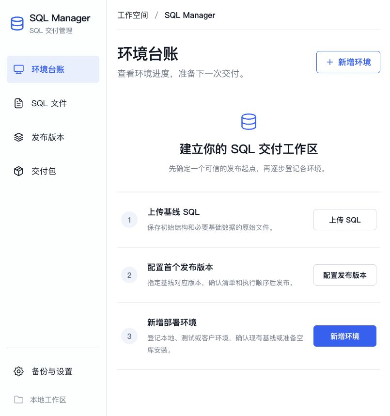

# SQL Manager

SQL Manager 是一个自托管的 SQL 脚本交付和执行台账工具。它根据各环境的 SQL 执行进度生成升级到目标版本所需的脚本包。执行人按清单运行 SQL，并在台账中登记结果。



## 主要功能

- **脚本管理** 上传、预览和下载 UTF-8 `.sql` 文件，保留原始字节与 SHA-256 校验值。单文件上限为 10 MiB。
- **发布版本** 选择一个或多个安装基线，分别编排基线和增量脚本的执行顺序。发布后锁定脚本清单。
- **环境交付** 独立记录应用版本和 SQL 执行进度，按环境生成首次安装包或增量升级包。ZIP 内含 SQL 原文件、执行顺序、交付说明和登记 CSV。
- **执行台账** 逐文件记录成功、失败、部分执行或未执行。修正时保留历史记录和原因。
- **备份恢复** 将 SQLite 台账和 SQL 原文件导出为完整备份，并恢复到空工作区。

## 快速开始

构建需要 JDK 17 和 Node.js 22 或更新版本。项目自带 Maven Wrapper。

```sh
./scripts/build.sh
./scripts/start.sh
```

打开 [http://127.0.0.1:18080/](http://127.0.0.1:18080/) 进入工作区。`build.sh` 将前端和后端打包到同一个 JAR，运行时只需 Java。

JAR 默认监听所有网络接口。部署到服务器后，可使用该服务器的 IP 或域名加 `18080` 端口访问。直接运行 JAR 时可通过 `SERVER_ADDRESS` 和 `SERVER_PORT` 指定监听地址和端口。

如需边改前端边调试后端，可按[本地开发](#本地开发)分别启动。

## 使用流程

1. 在 **SQL 文件** 中上传全量基线，选择 **安装基线**。
2. 在 **发布版本** 中创建首个版本，勾选一个或多个基线文件并调整顺序，基线全部排在增量脚本之前执行。核对后发布，后续版本继承全部基线并按执行顺序添加增量脚本。
3. 在 **环境台账** 中登记目标环境、实际数据库名和当前代码版本。已有数据库在核实后登记基线，空数据库生成首次安装包。
4. 选择目标环境和版本，预览并下载 ZIP。现场执行后，在 **交付包** 中逐个登记结果。台账根据登记结果更新 SQL 执行进度。

## Docker 部署

### Docker Compose

从项目根目录构建并启动。

```sh
./scripts/build.sh
docker compose up -d --build
```

Compose 默认在宿主机发布 `18080` 端口，可通过 `SQL_MANAGER_PORT` 调整。通过部署机的 IP 或域名及该端口访问应用。数据保存在 Docker 命名卷中，重建容器后可继续使用同一工作区。

### JAR 与 Dockerfile

构建后，`target/deploy/` 包含 `sql-manager.jar` 和 `Dockerfile`。将两个文件复制到同一个部署目录后构建镜像并启动容器。

```sh
docker build -t sql-manager:1.0.0 .
docker run -d --name sql-manager --restart unless-stopped \
  -p 18080:18080 \
  -v sql-manager-data:/data \
  sql-manager:1.0.0
```

Docker 镜像自带 JDK 17。容器启动后，可通过 `http://127.0.0.1:18080/api/health` 检查服务状态。

## 数据与备份

SQL Manager 使用共享工作区，每个工作区管理一个逻辑业务库。能访问应用的客户端可读写同一份台账，访问权限由部署环境控制。本地运行默认使用 `data/`，可通过 `DATA_DIR` 指定其他目录。每个数据目录由一个运行实例使用。

在 **备份与设置** 中可以下载或恢复完整备份。在线备份与恢复支持最多 2,000 个 SQL 文件、16 MiB 台账 JSON，以及各 128 MiB 的 SQL 原文件总量和 ZIP 文件。离线迁移时，先停止服务，再复制整个数据目录。

## 本地开发

联调时用 npm 启动 Vite 前端，用 IntelliJ IDEA 运行后端。无需执行 `./scripts/build.sh`、`./scripts/start.sh` 或 `npm run build`。

### 后端用 IDEA

1. 用 IntelliJ IDEA 打开仓库根目录，将项目 SDK 设为 **JDK 17**。
2. 若 Maven 项目未自动导入，右键 [backend/pom.xml](backend/pom.xml)，选择 **Add as Maven Project**。
3. 选择共享的 [SQL Manager 运行配置](.run/SQL%20Manager.run.xml)，点击 **Run** 或 **Debug**。后端默认监听 `18080` 端口。

### 前端用 npm

使用 Node.js 22 或更新版本，从仓库根目录执行以下命令。首次安装依赖或锁文件变更后运行 `npm ci`。

```sh
cd ui-prototype
npm ci
npm run dev -- --port 4173
```

打开 Vite 在终端中显示的访问地址。Vite 会把 `/api` 请求代理到 `18080` 端口，前端改动会热更新。

## 技术栈与验证

后端使用 Java 17、Spring Boot 和 SQLite，前端使用 React 和 Vite。

- [API 约定](docs/api-contract.md)
- [功能验证与运行命令](docs/implementation-validation.md)
