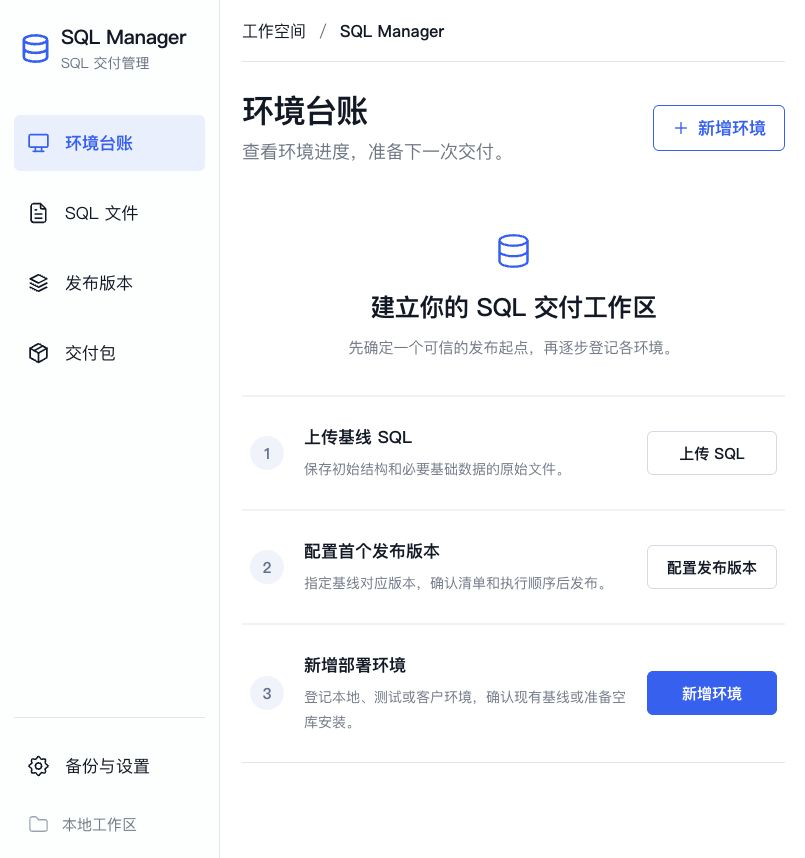
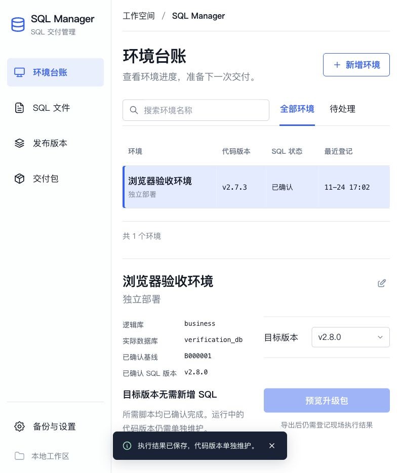

# SQL Manager 第一版实施验收

验收日期：2026-11-24。界面沿用已确认的 UI 方案 1。

## 已交付

- 原生 UTF-8 SQL 文件上传、预览、原文件下载与 SHA-256 校验。
- 指定首个基线版本、编排增量脚本顺序、发布冻结及累计版本链。
- 环境信息、人工基线确认、独立维护的代码版本与 SQL 确认状态。
- 按环境差集生成 ZIP 交付包，保留原文件、顺序清单、执行说明与登记 CSV。
- 按脚本登记成功、失败、部分执行、未执行；修改登记追加历史与原因。
- SQLite 台账与本地 SQL 原文件、完整备份、空工作区恢复。
- JAR 本地启动、Docker 镜像构建和持久化卷运行。

## 验证结果

| 验证 | 结果 | 覆盖内容 |
| --- | --- | --- |
| 前端模型测试 | 10 项通过 | 空工作区、累计版本差集、仅代码发布、安装与接管边界、失败阻断、降级保护、多交付包登记、无效版本链 |
| Java 测试 | 9 项通过，0 失败、0 错误 | 6 项业务服务测试、3 项 HTTP 控制器测试 |
| 实际 JAR HTTP 集成验收 | 15 组检查通过 | 原始 UTF-8/BOM/CRLF 字节、任意首版本、基线接管、安装与升级、ZIP 顺序和校验、失败与修正、输入校验、并发冲突、重启持久化、备份恢复、Origin/Host 限制 |
| Docker 构建 | 通过 | 多阶段构建、正式前端静态资源入 JAR、非 root 运行、回环端口映射 |
| Docker 容器重建验收 | 通过 | 删除首个容器后使用同一命名卷新建容器，完整台账、revision 和 SQL 原字节一致 |
| 浏览器操作验收 | 通过 | 上传、建版本、发布、新增环境、登记基线、生成升级包、逐文件登记结果及刷新持久化 |

浏览器验收使用独立临时工作区：上传基线并发布 `v2.7.3`，登记环境基线，上传增量并发布 `v2.8.0`，生成交付包并人工登记成功。刷新后 SQL 确认版本为 `v2.8.0`，代码版本仍为单独填写的 `v2.7.3`；基线确认依据与执行登记说明均可查阅。整个过程没有连接或执行任何业务数据库 SQL。

Docker 验收仅使用本次创建的临时容器和卷，结束后已清理。HTTP 验收使用临时目录，不接触正式工作区。

## 初次验收启动状态

- 地址：`http://127.0.0.1:8080/`。
- 数据目录：项目根目录 `data/`。
- 工作区为空，未带入测试脚本、环境或台账。
- 已验证正式 JAR 页面正常显示、设置页数据目录正确，浏览器无 warning/error 日志。

后续根据本机 IDEA 运行需求，默认端口已统一调整为 **18080**；当前访问地址为 `http://127.0.0.1:18080/`。上述 8080 地址及截图属于初次验收记录。

### IDEA 与端口调整复验

- 已在当前 IDEA 项目导入 `backend/pom.xml`，修正重复的手工源码目录标记，使用 JDK 17。
- 已通过共享 **SQL Manager** Application 配置实际启动，日志确认 Tomcat 监听 `18080`。
- 已在浏览器确认页面正常、无 warning/error 日志，数据目录仍为项目根目录 `data/`。
- 后端默认值、IDEA 环境变量、Vite API 代理、Docker 镜像及 Compose 映射均使用 `18080`。
- 前端构建、本地 JAR 构建、Compose 配置解析通过；重建后的 Docker 镜像内 9 项 Java 测试及容器重建持久化验收通过。
- 没有停止或修改其他项目的 8080 服务。



[IDEA 启动日志截图](../ui-prototype/design/idea-running.png)




## 第一版边界

第一版面向单人本地工作区，管理一个逻辑业务库 `business`，各环境填写对应的实际库名。SQL 由现场人员执行，工具只保存文件、交付清单与人工登记，不验证真实数据库结构。实际代码版本与 SQL 状态分别维护。

在线备份与恢复规模限制、启动方式及更新注意事项见 [运行说明](../README.md)。这次验收覆盖功能闭环和持久化，未开展大规模负载测试。

## 复现

```sh
npm --prefix ui-prototype test
./scripts/build.sh
python3 scripts/smoke_test.py
docker build -t sql-manager:1.0.0 target/deploy
python3 scripts/docker_smoke_test.py
```

HTTP 验收使用已构建的 JAR；代码变化后先停止本地服务，再运行 `./scripts/build.sh` 更新构建产物。
